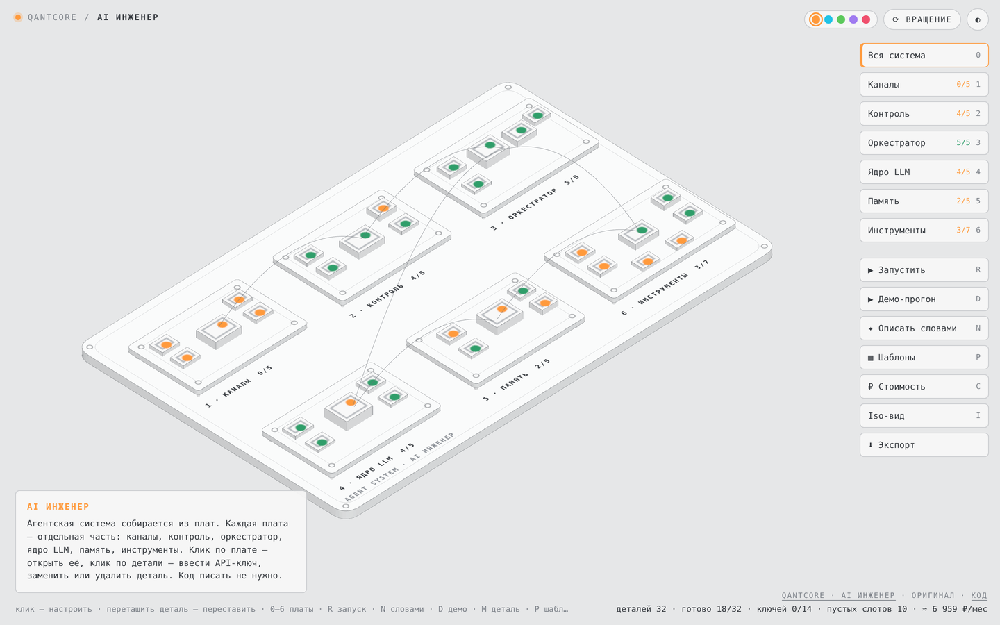
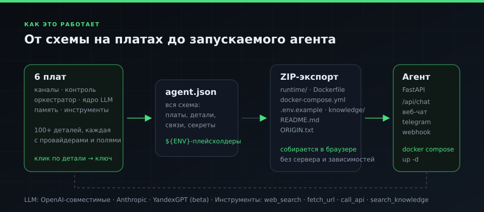
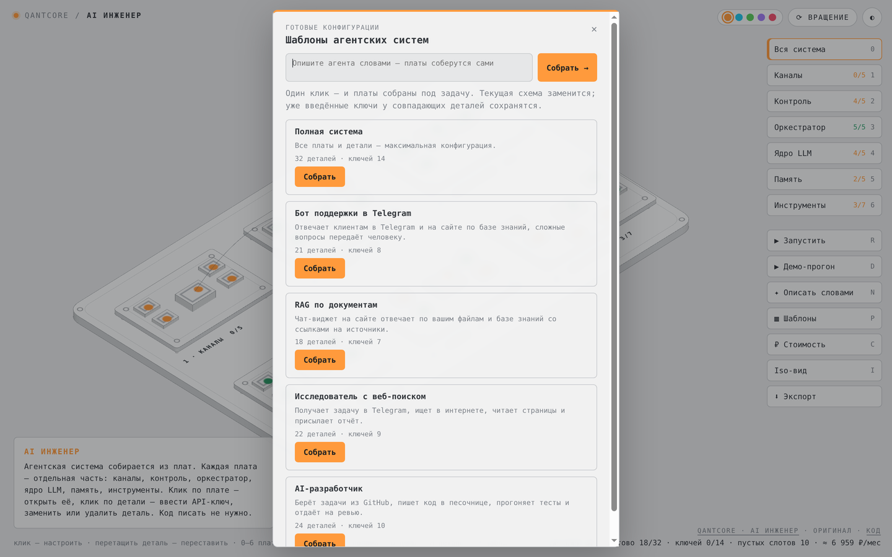
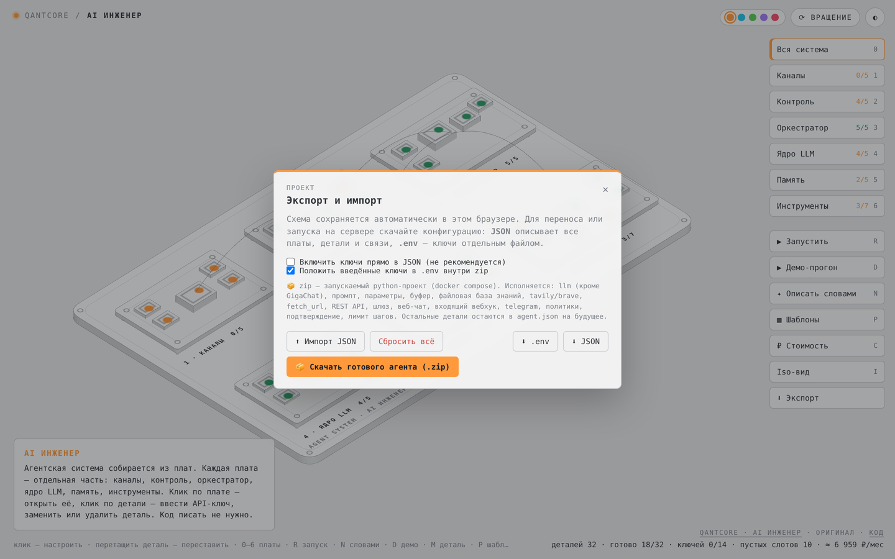
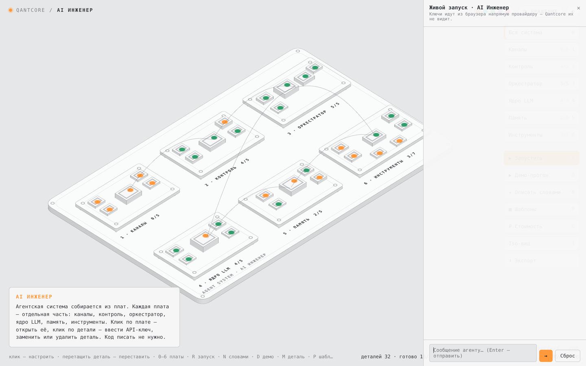

# Qantcore AI Engineer

[](LICENSE)
[](https://github.com/AliShovk/qantcore-ai-engineer/actions/workflows/validate.yml)


**A visual builder for AI agent systems.** Assemble an agent on six boards — channels, control, orchestrator, LLM core, memory, tools — plug in your own API keys, and export a **runnable project** (FastAPI + Docker) as a ZIP. No backend, no build step, no accounts.

- **Live demo:** https://qantcore.space/ai-engineer/
- **Original source:** https://github.com/AliShovk/qantcore-ai-engineer
- **License:** Apache-2.0 — see [LICENSE](LICENSE) and [NOTICE](NOTICE)



## How it works



Six boards hold parts. Every part has providers (variants) with typed fields: a model, an endpoint, a token, a channel path. When you export, the whole topology becomes `agent.json`, the runtime is fetched next to it, and everything is zipped **in the browser** — no server, no upload.

## Screenshots

| Templates | Export |
|---|---|
|  |  |

| Live run (your keys stay in the browser) | Isometric boards |
|---|---|
|  |  |

## Quick start

ES modules and WebGL, so it must be served over HTTP:

```bash
git clone https://github.com/AliShovk/qantcore-ai-engineer.git
cd qantcore-ai-engineer
python3 -m http.server 8080
# open http://localhost:8080/
```

No dependencies, no install step.

## What's inside

| Board | What you configure |
|---|---|
| **Channels** | web chat, Telegram, inbound webhook, gateway, widget |
| **Control** | guardrails, approval, limits, logging |
| **Orchestrator** | planner, routing, tool policy |
| **LLM core** | provider, model, temperature, context |
| **Memory** | history window, knowledge base, vector store |
| **Tools** | web search, fetch URL, REST calls, code, MCP |

Plus templates (full system, Telegram support bot, RAG over documents, web researcher, AI developer) and "describe it in words" assembly.

## What the exported project contains

```
agent.json          # the whole configuration: boards, parts, links, secret references
runtime/            # FastAPI runtime: main.py, llm.py, tools.py
Dockerfile
docker-compose.yml
requirements.txt
.env / .env.example # secrets, either inline or as placeholders
knowledge/          # .md/.txt files for RAG
ORIGIN.txt          # origin and export time
README.md           # generated project README
```

The runtime executes channels (web chat, Telegram, inbound webhook, gateway), the LLM core and its tools. Parts it does not execute stay in `agent.json`; the generated README always lists which ones are executed and which are config-only.

## Project structure

```
index.html            # shell: styles, import map, boards
app.js                # UI, boards, modals, export/import
boards.js             # catalogue of parts and their fields
model.js              # state, templates, defaults (pure, tested)
compose.js            # "describe the agent in words" → configuration
cost.js, prices.js    # token prices and monthly cost estimate (pure, tested)
runner.js             # live run against provider APIs (pure core, tested)
exporter.js           # ZIP builder and project generator
runtime/              # Python runtime shipped with every export (+ tests)
vendor/               # three.js and OrbitControls (MIT)
test-ai-engineer.mjs  # 31 unit tests (node --test)
```

## Tests

```bash
node --test test-ai-engineer.mjs          # 31 tests: templates, variants, cost, zip, runner, compose
python3 -m unittest runtime.test_runtime  # 12 tests: tool loop, tool_calls wire format, env, SSRF guard
```

Both suites run in CI on every push and pull request.

## Security model

- API keys are typed in the browser and go straight to the provider's endpoint (`api.openai.com`, `api.anthropic.com`, compatible gateways). Nothing is proxied.
- The app has no backend and stores nothing server-side; the configuration lives in your browser's `localStorage`.
- In the exported runtime, `fetch_url` blocks private and loopback addresses and re-checks every redirect hop; `/api/chat` can be closed with a gateway access key.
- Export can embed keys into `.env` — off by default and marked as not recommended.

## Known limitations

GigaChat is not supported yet (the runtime fails with a clear message). Budget and tracing parts (Langfuse/LangSmith) are configuration-only. Gemini, YandexGPT and GigaChat are blocked by CORS in the browser demo — the drawer explains it and points to the exported runtime.

## Contributing

Issues and pull requests are welcome — see [CONTRIBUTING.md](CONTRIBUTING.md). Two rules matter most: do not break the exported runtime (run the tests), and do not remove the origin markers.

---

## По-русски

Визуальный конструктор агентских систем: собираете агента на шести платах, вводите свои API-ключи и выгружаете **готовый к запуску проект** — ZIP с `agent.json`, Python-рантаймом, Dockerfile и `docker-compose.yml`.

- Демо: https://qantcore.space/ai-engineer/
- Запуск локально: `python3 -m http.server 8080` в папке проекта → `http://localhost:8080/`
- Тесты: `node --test test-ai-engineer.mjs` и `python3 -m unittest runtime.test_runtime`
- Ключи вводятся в браузере и уходят провайдеру напрямую; на сервере ничего не хранится
- Лицензия Apache-2.0; название и логотип «Qantcore» лицензией не покрываются
